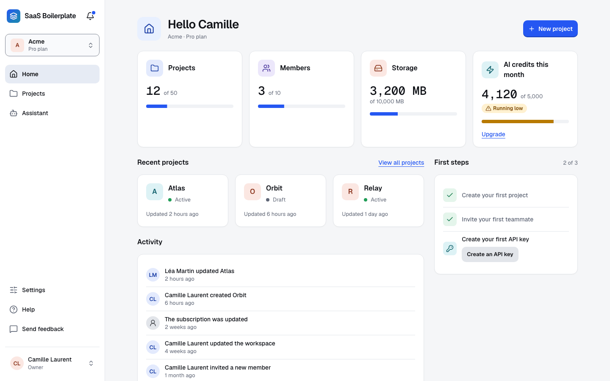
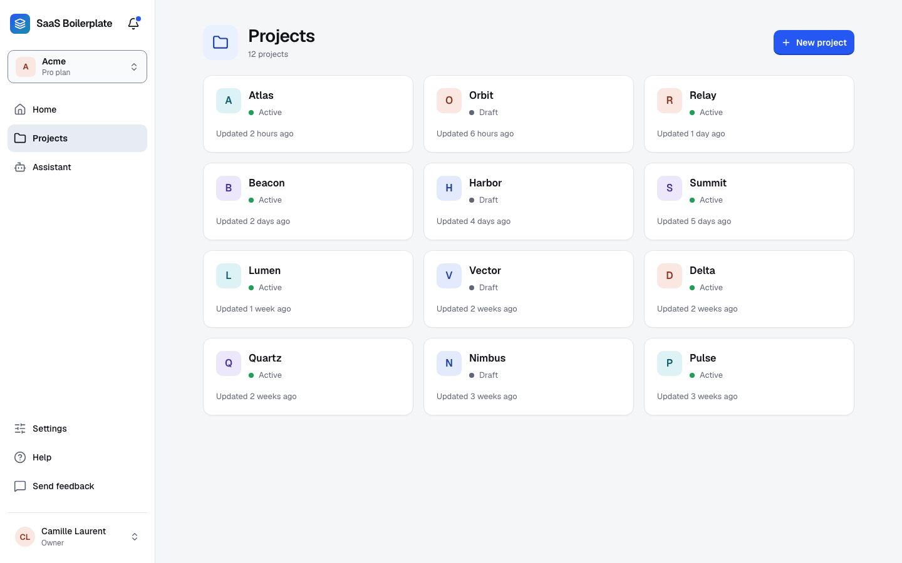
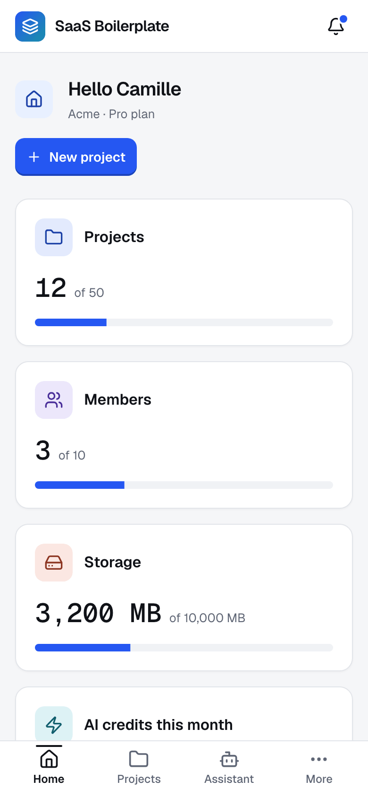
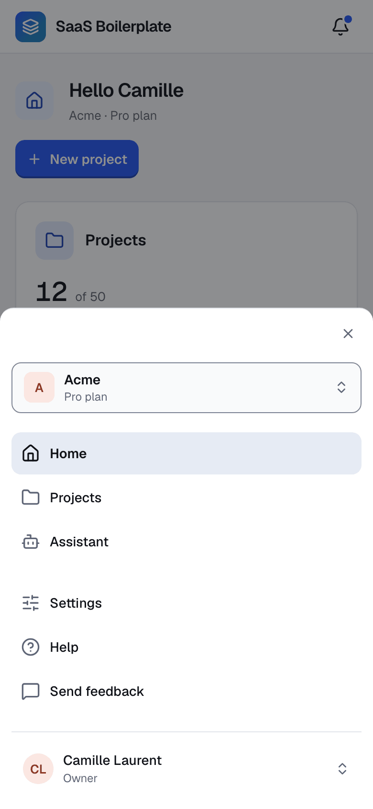
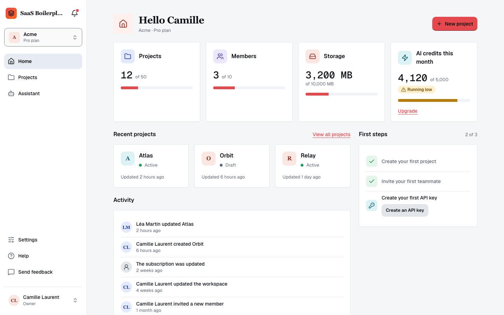
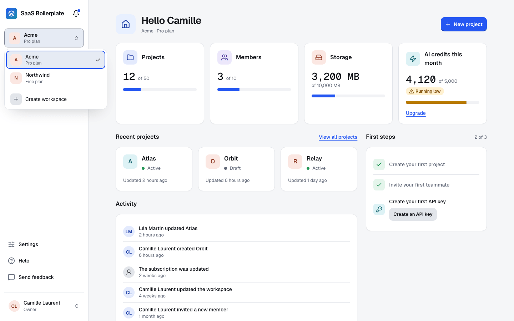
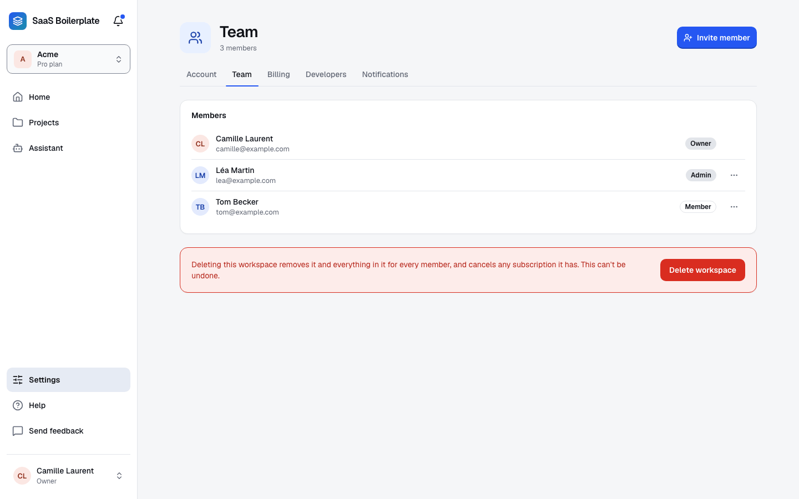
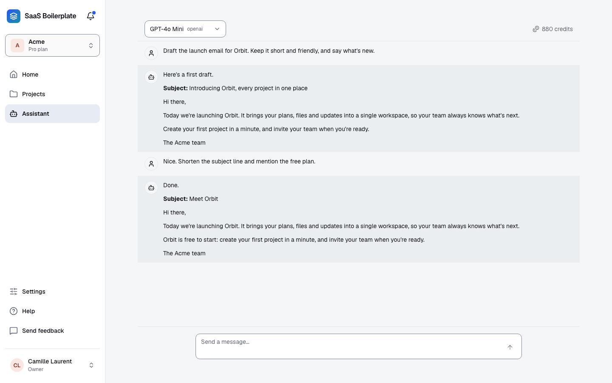

<div align="center">

# SaaS Boilerplate — Next.js 16 + Better Auth + Stripe (2026)

**Stop rebuilding auth, billing, and multi-tenancy for every new SaaS.**

Every project starts the same way. Your AI agents burn tokens regenerating the same foundation.
Clone this once, and go straight to building what makes your product unique.

[](https://github.com/nmarijane/saas-boilerplate/actions/workflows/ci.yml)


**20+ features** -- Auth, Stripe, RBAC, API keys, webhooks, feature flags, admin panel, and more.
**Zero config** -- `npm install && npm run db:seed && npm run dev`. Local PGlite database, no external service needed.
**AI-native** -- `CLAUDE.md` + `docs/SETUP.md` included so your agents have full context from day one.

<picture>
  <source media="(prefers-color-scheme: dark)" srcset="docs/screenshots/home-desktop-dark.png">
  
</picture>

</div>

---

## Workspace

Projects are the example entity: a list, a page for each project, and its settings. Replace them with your own.

<picture>
  <source media="(prefers-color-scheme: dark)" srcset="docs/screenshots/projects-desktop-dark.png">
  
</picture>

## Mobile navigation

Under 480 px the sidebar becomes a tab bar: up to four pages, then More, which opens the rest in a drawer.

<p>
  <picture>
    <source media="(prefers-color-scheme: dark)" srcset="docs/screenshots/home-mobile-dark.png">
    
  </picture>
  <picture>
    <source media="(prefers-color-scheme: dark)" srcset="docs/screenshots/menu-mobile-dark.png">
    
  </picture>
</p>

## Replaceable design system

The look is a set of tokens in `src/styles/theme.css`, and no component holds a color of its own. Four of them set a brand. The default theme is on the left, another brand on the right:

```css
--brand: #E5484D;
--brand-2: #F76B15;
--corner-card: 4px;
--typeface-display: Georgia, serif;
```

A mid-tone brand like this red also needs a dark ink on it (`--brand-on`) and lighter hover and press colors, which the picture on the right sets too: see [Rebrand in one file](docs/SETUP.md#rebrand-in-one-file).

<p>
  
  
</p>

## Organizations

Workspaces with owner, admin and member roles. Switch between them from the sidebar, invite people, and manage the team from the settings.

<p>
  <picture>
    <source media="(prefers-color-scheme: dark)" srcset="docs/screenshots/switcher-desktop-dark.png">
    
  </picture>
  <picture>
    <source media="(prefers-color-scheme: dark)" srcset="docs/screenshots/team-desktop-dark.png">
    
  </picture>
</p>

## AI assistant

A chat that works with OpenAI, Anthropic, Google or Groq, and a monthly credit balance for each workspace, tied to its plan (a new workspace starts with none: the flow that sells a plan, which the boilerplate does not have yet, is where its credits are allocated). Ollama is wired as a provider, but no model of the list runs on it yet: to use it, add one to the model list (`src/features/ai/config/models.ts`).

<picture>
  <source media="(prefers-color-scheme: dark)" srcset="docs/screenshots/assistant-desktop-dark.png">
  
</picture>

---

> [!TIP]
> **Setup with Claude Code**
>
> The fastest way to start a new project from this boilerplate is with [**saas-forge**](https://github.com/nmarijane/saas-forge) — a Claude Code plugin that brainstorms your idea, scaffolds the project, removes what you don't need, and generates your business logic automatically.
>
> ```bash
> # Install the plugin
> npx skills add nmarijane/saas-forge
>
> # Create your SaaS
> /saas-forge:saas A project management tool for freelancers
> ```
>
> saas-forge will:
> 1. **Brainstorm** your idea — data model, user flows, which features to keep or remove
> 2. **Scaffold** the project — clone, customize, clean up unused features
> 3. **Generate** your business code — Drizzle models, server actions, components, pages
>
> No manual setup. No guessing which files to delete. Just describe your app and go.

---

## Quick Start (manual)

```bash
# Clone
git clone https://github.com/nmarijane/saas-boilerplate.git my-saas
cd my-saas

# Install (Node 22.13 or later: `.nvmrc` says 22)
npm install

# Create the local PGlite database (./local.db) with the dev accounts
npm run db:seed

# Start the dev server
npm run dev
```

Open [http://localhost:3088](http://localhost:3088). See the full [Setup Guide](docs/SETUP.md) for env vars, feature removal, and deployment.

---

## Built With

<p>
  <a href="https://nextjs.org"></a>
  <a href="https://react.dev"></a>
  <a href="https://www.typescriptlang.org"></a>
  <a href="https://tailwindcss.com"></a>
  <a href="https://ui.shadcn.com"></a>
  <a href="https://www.postgresql.org"></a>
  <a href="https://orm.drizzle.team"></a>
  <a href="https://stripe.com"></a>
  <a href="https://sentry.io"></a>
  <a href="https://storybook.js.org"></a>
  <a href="https://vitest.dev"></a>
  <a href="https://playwright.dev"></a>
  <a href="https://www.docker.com"></a>
  <a href="https://eslint.org"></a>
  <a href="https://prettier.io"></a>
  <a href="https://github.com/features/actions"></a>
  <a href="https://www.inngest.com"></a>
</p>

| Layer | Technology |
|-------|-----------|
| **Framework** | Next.js 16 (App Router) + React 19 |
| **Language** | TypeScript (strict mode) |
| **Styling** | Tailwind CSS 4 + shadcn/ui |
| **Auth** | Better Auth (self-hosted, not Clerk) |
| **Database** | Drizzle ORM + PostgreSQL (PGlite for local dev) |
| **Payments** | Stripe (checkout, portal, webhooks) |
| **Emails** | React Email + Nodemailer (SMTP) |
| **Jobs** | Inngest (background tasks, retries) |
| **i18n** | next-intl (en, fr) |
| **Monitoring** | Sentry + LogTape |
| **Testing** | Vitest + Playwright + Storybook |
| **CI/CD** | GitHub Actions + Dependabot + Claude Code Review |

---

## Features

**Core** -- Authentication (email, Google, GitHub, MFA), multi-tenancy (orgs, RBAC), Stripe billing (checkout, portal, webhooks), onboarding wizard

**Platform** -- A connected app shell (sidebar, workspace switcher, account menu, tab bar on phones), a workspace home (quotas against the plan, first steps, latest activity), admin panel (users, orgs, audit log, feature flags, changelog, waitlist, metrics), settings in five groups (account, team, billing, developers with API keys and webhooks, notifications), in-app notifications

**Developer** -- API keys (SHA-256 hashed, scoped), webhooks (HMAC-SHA256 signed, delivery log), feature flags (plan/org gating), an event bus, audit log, file upload (local + S3), rate limiting (memory/Redis/Upstash), feedback widget, email templates, health check

**Security** -- Security headers (CSP, HSTS, X-Frame-Options), Zod validation, session-based API auth, role-based access control, `safeAction` error wrapper

**CI/CD** -- 6 parallel jobs (lint, typecheck, test, build, storybook, audit), automatic coverage badge, Dependabot weekly updates, and **Claude Code AI reviewer** that reviews every PR for security, quality, and convention adherence. Mention `@claude` in any PR comment to get AI assistance.

---

## Project Structure

```
src/
  app/                    # Next.js routes (App Router)
    [locale]/             # i18n routing (en, fr)
      (marketing)/        # Public pages (landing, pricing, about, blog, changelog, legal, waitlist)
      (auth)/             # Sign-in, sign-up, verify-email, forgot-password, reset-password
      (app)/              # Signed-in app
        (shell)/          # Pages inside the app shell (dashboard, projects, ai, settings, admin)
        onboarding/       # Welcome steps, without the shell
    api/                  # API routes
  features/               # Feature modules (isolated)
    registry.ts           # The features installed, one line each
    app-shell.ts          # Data of the app shell, titles of the pages
    admin/                # Admin panel (users, orgs, metrics)
    ai/                   # AI assistant (chat, credits)
    api-keys/             # API key management (SHA-256)
    audit/                # Audit log with retention
    auth/                 # Better Auth, organizations, RBAC
    billing/              # Stripe, plans, webhooks
    blog/                 # Blog (MDX articles in content/blog)
    changelog/            # Product changelog
    dashboard/            # Workspace home (activity, first steps)
    email/                # React Email templates
    events/               # Event bus
    feature-flags/        # Feature flags (plan/org gating)
    feedback/             # Feedback widget + admin review
    jobs/                 # Background jobs (Inngest)
    notifications/        # In-app notifications
    onboarding/           # 3-step wizard
    projects/             # Example entity (list, page, settings)
    settings/             # User & org settings
    upload/               # File upload (local + S3)
    waitlist/             # Waitlist
    webhooks/             # Webhook delivery + HMAC signatures
  shared/                 # Shared code
    components/           # shadcn/ui, app shell, foundations stories and reusable components
    config/               # App name, help link, protected paths
    hooks/                # React hooks
    lib/                  # DB, env, logger, i18n, SEO, rate-limit
    shell/                # FeatureShell contract and shell view
    types/                # Global types
    utils/                # Generic helpers
  models/                 # Drizzle ORM schemas
  locales/                # Translation files (en.json, fr.json)
  styles/                 # Theme tokens (theme.css), Tailwind mapping (global.css), fonts
  proxy.ts                # Rate limiting, i18n, auth guards
```

---

## Commands

```bash
# Development
npm run dev              # Start dev server (PGlite, hot reload)
npm run storybook        # Start Storybook on port 6006
npm run email:dev        # Preview email templates

# Quality
npm run lint             # ESLint
npm run check:types      # TypeScript type check
npm run check:deps       # Unused dependencies (Knip)
npm run format           # Prettier

# Testing
npm run test             # Vitest (unit + integration)
npm run test:watch       # Vitest in watch mode
npm run test:e2e         # Playwright E2E tests: builds the app and serves it on port 3090 over a throwaway database

# Database
npm run db:generate      # Generate Drizzle migration
npm run db:migrate       # Apply migrations to PostgreSQL (DATABASE_URL, from .env.local like the app); PGlite uses db:seed
npm run db:studio        # Open Drizzle Studio
npm run db:seed          # Apply migrations (PGlite included), seed the plans, then the admin, dev and demo accounts (password admin123): not in production, and only on a local database (SEED_DEMO=1 for any other); prints the database it targets; safe to re-run (stop npm run dev first)

# Production
npm run build            # Production build
npm start                # Start production server
npm run docker:up        # Start with Docker Compose
```

---

## Environment Variables

Copy `.env.example` to `.env.local` and fill in the values:

```bash
# Required for production
DATABASE_URL=              # PostgreSQL connection string
BETTER_AUTH_SECRET=        # Auth secret (generate with openssl rand -hex 32)
BETTER_AUTH_URL=           # Your app URL (https://your-app.com)
STRIPE_SECRET_KEY=         # Stripe secret key
STRIPE_WEBHOOK_SECRET=     # Stripe webhook signing secret

# Optional
NEXT_PUBLIC_APP_URL=       # App URL (default: http://localhost:3088)
GOOGLE_CLIENT_ID=          # Google OAuth
GOOGLE_CLIENT_SECRET=
GITHUB_CLIENT_ID=          # GitHub OAuth
GITHUB_CLIENT_SECRET=
SMTP_HOST=                 # Email SMTP
SMTP_PORT=
SMTP_USER=
SMTP_PASS=
EMAIL_FROM=
SENTRY_DSN=                # Sentry error tracking
OPENAI_API_KEY=            # AI assistant: it is on as soon as one provider has a key
ANTHROPIC_API_KEY=         #   (OLLAMA_BASE_URL is wired too, but no model of the list runs on it yet)
GOOGLE_GENERATIVE_AI_API_KEY=
GROQ_API_KEY=
S3_BUCKET=                 # S3 file storage (optional, local by default)
S3_REGION=
S3_ACCESS_KEY=
S3_SECRET_KEY=
```

> For local development, no environment variables are needed. The app uses PGlite, a database kept in `./local.db` (`PGLITE_DATA_DIR` moves it), and falls back to sensible defaults.

---

## Deployment

### Docker

```bash
npm run docker:up
```

### Vercel / Railway / Fly.io

1. Connect your repository
2. Set environment variables
3. Build command: `npm run build`
4. Start command: `npm start`

---

## What is saas-boilerplate?

saas-boilerplate is a production-ready Next.js 16 starter kit for building SaaS applications in 2026. It includes authentication (Better Auth), Stripe billing, multi-tenancy with RBAC, API keys, webhooks, feature flags, an admin panel, and 20+ pre-built features — all wired together and tested. Clone it, run `npm install && npm run db:seed && npm run dev`, and start building your product logic immediately. No configuration required.

---

## Why saas-boilerplate?

- **Better Auth, not Clerk or Supabase Auth** — self-hosted auth with organizations, RBAC, MFA, and no per-seat pricing. Stop paying $25/mo per team member just for login.
- **Zero-setup local dev** — PGlite, a database kept in a local folder (`./local.db`), means no Docker and no Postgres setup. Run `npm run db:seed`, then `npm run dev`.
- **AI-native from day one** — `CLAUDE.md` and structured docs are included so Claude Code and other coding agents have full project context immediately. Your agents don't waste tokens rediscovering your stack.
- **20+ features, production-tested** — auth, billing, multi-tenancy, audit log, webhooks, feature flags, admin panel, file upload, rate limiting. Not stubs — working implementations.
- **Claude Code AI reviewer on every PR** — automated code review for security, quality, and convention adherence, built into CI.

---

## How does saas-boilerplate compare to alternatives?

| | saas-boilerplate | ShipFast | Makerkit | Supastarter |
|---|---|---|---|---|
| **Price** | Free (MIT) | $299 one-time | $299/yr | $299 one-time |
| **Auth** | Better Auth (self-hosted) | NextAuth | Supabase Auth | Supabase Auth |
| **Multi-tenancy** | ✅ (orgs + RBAC) | ❌ | ✅ | ✅ |
| **Admin panel** | ✅ full-featured | ❌ | partial | ❌ |
| **AI-native** | ✅ CLAUDE.md included | ❌ | ❌ | ❌ |
| **AI code review** | ✅ Claude on every PR | ❌ | ❌ | ❌ |
| **Zero-config dev** | ✅ PGlite | ❌ | ❌ | ❌ |
| **Open source** | ✅ MIT | ❌ closed | ❌ closed | ❌ closed |

ShipFast is popular and well-marketed, but it's closed-source, costs $299, lacks multi-tenancy, and uses NextAuth. saas-boilerplate gives you more features, full source access, Better Auth (no per-seat cost), and a true zero-config dev experience — for free.

---

## FAQ

**Can I use this for a commercial SaaS?**
Yes. MIT license. No attribution required, no royalties.

**Why Better Auth instead of Clerk or Auth0?**
Clerk charges per monthly active user (~$0.02/MAU after free tier). At 10,000 users that's $200/month just for auth. Better Auth is self-hosted — you pay nothing beyond your server costs. It supports organizations, RBAC, MFA, and OAuth out of the box.

**Does this work with Vercel, Railway, and Fly.io?**
Yes. See the [Deployment](#deployment) section. Connect your repo, set env vars, done.

**What database does this use?**
PostgreSQL in production via Drizzle ORM. PGlite (a local folder, `./local.db`) for local development — no Docker required.

**Is there a version with Supabase or Prisma?**
No. This stack is opinionated: Drizzle + Better Auth + Next.js App Router. If you want Prisma or Supabase Auth, this is not the right template.

---

## Contributing

1. Fork the repository
2. Create a feature branch (`git checkout -b feat/my-feature`)
3. Commit with conventional commits (`feat:`, `fix:`, `docs:`, etc.)
4. Push and create a Pull Request

Pre-commit hooks enforce linting, type checking, and commit message format.

---

## License

MIT
